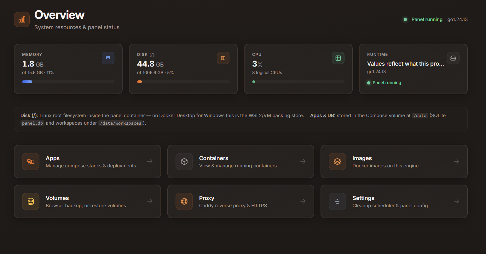

<div align="center">

# NextDeploy v2

**Self-hosted Docker deployment & CloudPanel-style PHP hosting panel** — Compose stacks, instant pre-built PHP runtimes with CVE alerts, automated HTTPS, native AI MCP server, and live logs from one clean UI.

[](https://github.com/masudranaxpert/NextDeploy/releases)
[](https://hub.docker.com/r/masudranaxpert/nextdeploy-v2)
[](LICENSE)
[](https://go.dev)



</div>

---

## What's New in v2

- ⚡ **Instant PHP Hosting (5–10s provision)**: Pre-built Docker Hub runtimes (`masudranaxpert/nextdeploy-php:7.4` to `8.5`) pre-baked with MongoDB, Redis, MySQL, GD, Imagick, OPcache, Composer, and WP-CLI. No more waiting 15 minutes to compile on small VPS servers.
- 🛡️ **Active CVE & EOL Security Auditing**: Real-time vulnerability badges and CVSS ratings (including critical 2026 PHP2Shell CVE-2026-109618/109619 RCE warnings and EOL status for 7.4/8.0/8.1) right in the PHP version manager.
- 🚀 **Advanced Asset Optimization**: Pre-compressed Gzip assets, vendor chunking, and sub-millisecond virtual tree rendering for large workspaces.
- 🧠 **NextDeploy AI (ND AI)**: a built-in admin agent powered by [omp](https://github.com/can1357/oh-my-pi) over its RPC protocol. It checks sites, containers, logs, deploys and backups, and can fix them. It sits at `/nextdeploy-ai`, and its logins, skills and chats live in your data volume.
- 🤖 **Native MCP Server**: Directly connect Cursor, Claude Code, or Windsurf to inspect, deploy, and edit code with 18+ tools over SSE.

---

## Quick Install (One Command)

```bash
curl -fsSL https://raw.githubusercontent.com/masudranaxpert/NextDeploy/main-v2/install.sh | sudo bash
```

With custom domain and Let's Encrypt email:

```bash
curl -fsSL https://raw.githubusercontent.com/masudranaxpert/NextDeploy/main-v2/install.sh | sudo bash -s -- \
  --domain panel.example.com --email admin@example.com
```

| Option | Default | Description |
|---|---|---|
| `--domain` | *(none)* | Panel domain (automatic HTTPS via Caddy) |
| `--email` | *(none)* | Let's Encrypt / ACME notification email |
| `--dir` | `/opt/nextdeploy` | Host installation directory |
| `--data-dir` | `/data` | Host persistent data path |

After install, open **`http://<server-ip>:8080`** to set up your admin account.

---

## Core Capabilities

| Category | Features |
|---|---|
| **PHP & WordPress** | PHP 7.4–8.5 runtimes, MariaDB databases, WP-CLI, cron jobs, php.ini tuning, php-fpm pools, CVE indicators |
| **Deploy Stacks** | Git webhook auto-deploy or manual file upload; automatic `docker-compose.yml` generation |
| **HTTPS & Routing** | Embedded Caddy proxy; zero-config SSL certificates via Let's Encrypt / ZeroSSL |
| **Files & Terminal** | In-browser file editor, upload/download, host & container interactive web terminals |
| **AI Integration** | Native [Model Context Protocol (MCP)](skills/nextdeploy-mcp/SKILL.md) server at `/mcp/sse` for AI dev agents |
| **Resource Limits** | Per-container CPU / Memory limits, live container metrics, and scheduled Docker prune |
| **VPS Migration** | Export apps to a `.nd-migrate` bundle and one-command import onto another VPS |

---

## NextDeploy AI (ND AI)

ND AI runs [omp](https://github.com/can1357/oh-my-pi) as a child process of the panel and talks to it only through omp's RPC protocol, so models, skills, slash commands, approval modes and chat history all come from omp itself. Admin-only.

- **State** lives in `<data>/omp/` (`agent/` for logins, skills and conversations, `home/` for `~/.ssh` and friends), so it survives image updates.
- **Approvals** are omp's own modes: ask every time, ask once, ask before changes, or autonomous.
- **Upgrading omp** is a rebuild: the Docker image downloads and checksums the omp release (`--build-arg OMP_VERSION=v18.13.2` to pin, default `latest`).

### Resource benchmark

omp is only started when you use the AI page and is stopped again after 15 idle minutes (`ai_idle_minutes` key in the panel's settings table, `0` disables), so an idle panel pays nothing for it.

| State | RAM |
|---|---|
| Panel only, AI never used | ~35 MB |
| omp running, chat idle | ~259 MB |
| Heavy turn (bash + subagent + host tools), peak | ~316 MB |
| After the idle timeout | omp stopped (0 MB), panel ~36 MB |

<sub>Measured on a Linux dev machine with omp v18.13.2 and Gemini 3.8 Flash. Short chats; very long conversations were not measured. Treat it as a guide for sizing, about 300 MB of headroom while someone is chatting.</sub>

---

## Manual Run (Docker Compose)

```bash
mkdir -p /data
curl -fsSL https://raw.githubusercontent.com/masudranaxpert/NextDeploy/main-v2/docker-compose.yml -o docker-compose.yml
docker compose up -d
```

### Local Development / Build from Source

```bash
git clone https://github.com/masudranaxpert/NextDeploy.git -b main-v2
cd NextDeploy
npm run build
go build -o panel .
./panel
```

---

## Management & Updates

- **Update to latest v2**: `sudo nextdeploy-update`
- **Stream panel logs**: `sudo nextdeploy-logs`
- **Uninstall**: `curl -fsSL https://raw.githubusercontent.com/masudranaxpert/NextDeploy/main-v2/uninstall.sh | sudo bash`

---

## License

MIT — see [LICENSE](LICENSE).
