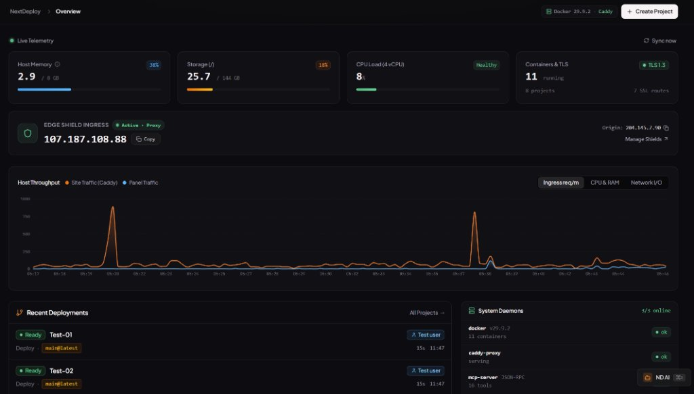

<div align="center">

# NextDeploy

**Lightweight self-hosted deployment platform & PHP hosting panel.**  
Run Docker Compose apps, WordPress & PHP sites, zero-config HTTPS via Caddy, Angie or Ferron, multi-panel Edge Shield, and full `nd` CLI control from a single fast binary.

[](https://github.com/masudranaxpert/NextDeploy/releases)
[](https://hub.docker.com/r/masudranaxpert/nextdeploy)
[](LICENSE)
[](https://go.dev)

<br/>

<a href="#quick-install">
  
</a>

</div>

---

## Why NextDeploy?

Most self-hosted hosting panels fall into two extremes: either heavy enterprise stacks that consume multiple gigabytes of memory just running management services, or traditional PHP-only shared hosting panels that have no concept of modern Docker Compose workflows or AI agent tooling.

NextDeploy is designed to be lean, modern, and developer-first:

- **~35 MB idle footprint**: One static Go binary (Fiber) plus a reverse proxy container of your choice (Caddy, Angie or Ferron). Leaves your VPS RAM for your actual applications.
- **Unified Hosting Model**: Run complex multi-container Docker Compose stacks right alongside production PHP/WordPress workloads (with isolated PHP-FPM pools & MariaDB).
- **Edge Shield Ingress**: Terminate TLS and absorb traffic on remote edge VPS nodes (`nd edge`) before tunneling back to your origin server, complete with per-domain trusted proxy preservation.
- **Optional AI Assistant**: An admin agent powered by [omp](https://github.com/can1357/oh-my-pi) with access to panel logs and runtime diagnostics. It is not installed by default; turn it on only if you want it (see [AI assistant](#ai-assistant-optional)).
- **Cross-Platform CLI (`nd`)**: Manage deployments, tail proxy/container logs, sync local workspaces, and inspect databases right from your terminal.

---

## Quick Install

Run this command on any fresh Ubuntu/Debian/RHEL Linux VPS (Docker will be installed automatically if not present):

```bash
curl -fsSL https://raw.githubusercontent.com/masudranaxpert/NextDeploy/main/install.sh | sudo bash
```

### Install with Custom Domain & Auto-HTTPS

```bash
curl -fsSL https://raw.githubusercontent.com/masudranaxpert/NextDeploy/main/install.sh | sudo bash -s -- \
  --domain panel.yourdomain.com --email admin@yourdomain.com
```

| Flag | Default | Purpose |
|---|---|---|
| `--domain` | *(none)* | Your panel domain (automatic Let's Encrypt TLS via the selected proxy engine) |
| `--email` | *(none)* | ACME registration & expiration notices |
| `--dir` | `/opt/nextdeploy` | Host installation and configuration directory |
| `--data-dir` | `/data` | Persistent data directory (apps, databases, TLS certs) |
| `--proxy` | `caddy` | Reverse proxy engine: `caddy`, `angie` or `ferron` (experimental). Prompts on a TTY when omitted. See [Proxy engines](#proxy-engines) |
| `--with-ai` / `--without-ai` | without | Install the optional AI assistant (~250 MB download). Prompts on a TTY when omitted. See [AI assistant](#ai-assistant-optional) |

After installation completes, navigate to **`http://<server-ip>:8080`** (or your domain) to create your initial administrator account.

---

## Proxy Engines

NextDeploy runs on **Caddy** by default. You can pick another engine at install time or switch later:

| Engine | Status | Best for |
|---|---|---|
| **Caddy 2** | Default, stable | Simplest setup, all features |
| **Angie 1.12.4** | Supported | Small VPS and Edge Shield nodes, many idle HTTP/2 connections |
| **Ferron 3.0.0-rc.11** | Experimental | Trying the fastest engine; has timeout and reload gaps |

```bash
sudo bash install.sh --proxy angie          # at install
nd proxy engine preflight angie             # later: check what would break
nd proxy engine set angie --yes             # switch, with automatic rollback
nd edge install --panel-url URL --token-stdin --proxy angie   # Shield node
```

Benchmarks, the decision guide, switching and rollback details are in [docs/proxy-engines.md](docs/proxy-engines.md). The design is recorded in [ADR 001](docs/adr/001-multi-proxy-drivers.md).

---

## AI Assistant (optional)

The panel image does not include the AI engine. Without it, NextDeploy works exactly the same, and the AI menu is hidden. Turn it on at any time:

```bash
sudo bash install.sh --with-ai     # at install
nd ai enable                       # later (or Settings → AI assistant)
nd ai status                       # version and disk use
nd ai disable --yes                # remove the engine; chats, logins and API keys are kept
nd ai disable --purge --yes        # also delete chats, logins and stored API keys
```

Enabling downloads the [omp](https://github.com/can1357/oh-my-pi) release this panel version is tested with (currently `v19.0.0`) for the server's CPU, checks it against the release's SHA256 checksums and stores it in `/data/plugins/omp`, so it survives panel updates. Disabling also deletes the tools omp downloads by itself: its native modules (~135 MB, on first start) and, only if you use the Gemini/Antigravity provider, the Antigravity CLI (~230 MB). Versions those tools replace during updates are cleaned up automatically. Offline servers can copy the `omp-linux-musl-<arch>` binary to `/data/plugins/omp` by hand. Panels that already used the assistant before it became optional keep it: the engine is downloaded again on the first start after the update.

---

## Feature Matrix

| Capability | What It Does |
|---|---|
| **PHP & WordPress** | Instant runtimes (PHP 7.4 to 8.5), MariaDB database & user provisioning, php-fpm pools, automatic `.htaccess` import into routing rules, WordPress page cache served by the proxy, WP-CLI, and cron management. |
| **Compose & Stacks** | Git webhook auto-deploy or local delta push (`nd push`), automatic blue/green container deployments, and environment variable vaults. |
| **Edge Shield (DDoS/Proxy)** | Multi-panel edge CDN architecture. Route traffic through distributed edge VPS nodes with automatic TLS synchronization on Caddy, Angie or Ferron, plus Shield-only domains and garbage-domain cleanup (`nd edge domain`). |
| **CLI Companion (`nd`)** | Inspect resources (`nd top`), stream container & proxy logs (`nd logs`, `nd proxy logs -f`), switch the proxy engine (`nd proxy engine`), delta sync files (`nd push --deploy`), and run interactive shell sessions (`nd shell`). |
| **Traffic per Site** | The Traffic page shows requests, 4xx/5xx errors and a per-minute trend for every project, PHP site and the panel over the last 15, 30 or 60 minutes. Numbers come from the proxy's own counters (Angie status zones, Caddy per-host metrics), read once a minute, so requests are never slowed down; users see only their own sites. |
| **Disaster Recovery** | Manual snapshots & scheduled backups with direct S3/Rclone cloud sync, plus `.nd-migrate` single-archive VPS-to-VPS migrations. |

---

## CLI (`nd`) Quickstart

Install the standalone CLI locally on your machine (macOS, Linux, or Windows):

```bash
curl -fsSL https://raw.githubusercontent.com/masudranaxpert/NextDeploy/main/install-nd.sh | bash
```

```bash
# 1. Authenticate with your panel
nd login --url https://panel.yourdomain.com --token nd_xxx

# 2. Link your local project directory
cd my-app
nd link my-app

# 3. Preview and push changes with automatic deployment
nd diff
nd push --deploy

# 4. Stream real-time container logs
nd logs -f
```

*(See [skills/nextdeploy-cli/SKILL.md](skills/nextdeploy-cli/SKILL.md) for full CLI command references.)*

---

## Docker Compose Manual Run

If you prefer to manage the panel stack directly via Docker Compose without the installer script:

```bash
mkdir -p /data/workspaces
curl -fsSL https://raw.githubusercontent.com/masudranaxpert/NextDeploy/main/docker-compose.yml -o docker-compose.yml
docker compose up -d
```

### Local Development

```bash
git clone https://github.com/masudranaxpert/NextDeploy.git
cd NextDeploy
npm install && npm run build
go build -o panel .
./panel
```

---

## Server Maintenance

- **Update Panel**: `sudo nextdeploy-update`
- **Follow Panel Logs**: `sudo nextdeploy-logs`
- **Uninstall**: `curl -fsSL https://raw.githubusercontent.com/masudranaxpert/NextDeploy/main/uninstall.sh | sudo bash`

---

## License

NextDeploy is released under the [MIT License](LICENSE).
