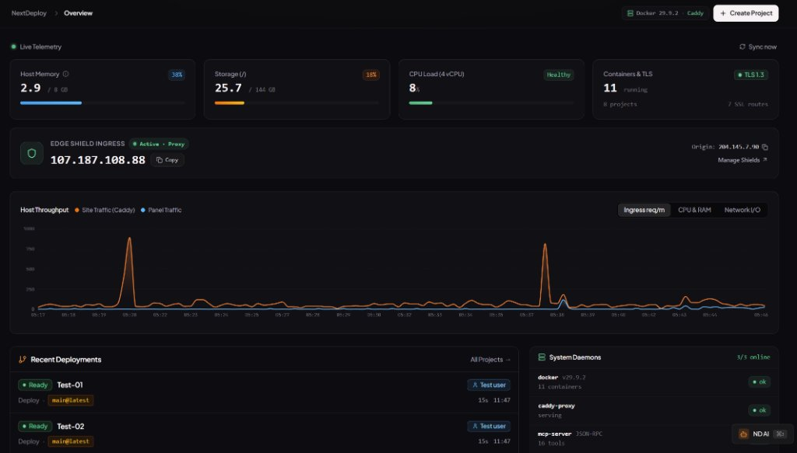

<div align="center">

# NextDeploy

**Lightweight self-hosted deployment platform & PHP hosting panel.**  
Run Docker Compose apps, WordPress & PHP sites, zero-config HTTPS via Caddy, multi-panel Edge Shield, and full dev agent MCP integration from a single fast binary.

[](https://github.com/masudranaxpert/NextDeploy/releases)
[](https://hub.docker.com/r/masudranaxpert/nextdeploy)
[](LICENSE)
[](https://go.dev)

<br/>

<a href="#quick-install">
  
</a>

</div>

---

## Why NextDeploy?

Most self-hosted hosting panels fall into two extremes: either heavy enterprise stacks that consume multiple gigabytes of memory just running management services, or traditional PHP-only shared hosting panels that have no concept of modern Docker Compose workflows or AI agent tooling.

NextDeploy is designed to be lean, modern, and developer-first:

- **~35 MB idle footprint**: Compiled static Go binary + Fiber + embedded Caddy reverse proxy. Leaves your VPS RAM for your actual applications.
- **Unified Hosting Model**: Run complex multi-container Docker Compose stacks right alongside production PHP/WordPress workloads (with isolated PHP-FPM pools & MariaDB).
- **Edge Shield Ingress**: Terminate TLS and absorb traffic on remote edge VPS nodes (`nd edge`) before tunneling back to your origin server, complete with per-domain trusted proxy preservation.
- **First-Class AI Agent Support**: Native [Model Context Protocol (MCP)](skills/nextdeploy-mcp/SKILL.md) server at `/mcp/sse` + built-in admin agent (ND AI) powered by [omp](https://github.com/can1357/oh-my-pi).
- **Cross-Platform CLI (`nd`)**: Manage deployments, tail proxy/container logs, sync local workspaces, and inspect databases right from your terminal.

---

## Quick Install

Run this command on any fresh Ubuntu/Debian/RHEL Linux VPS (Docker will be installed automatically if not present):

```bash
curl -fsSL https://raw.githubusercontent.com/masudranaxpert/NextDeploy/main/install.sh | sudo bash
```

### Install with Custom Domain & Auto-HTTPS

```bash
curl -fsSL https://raw.githubusercontent.com/masudranaxpert/NextDeploy/main/install.sh | sudo bash -s -- \
  --domain panel.yourdomain.com --email admin@yourdomain.com
```

| Flag | Default | Purpose |
|---|---|---|
| `--domain` | *(none)* | Your panel domain (automatic Let's Encrypt TLS via Caddy) |
| `--email` | *(none)* | ACME registration & expiration notices |
| `--dir` | `/opt/nextdeploy` | Host installation and configuration directory |
| `--data-dir` | `/data` | Persistent data directory (apps, databases, TLS certs) |

After installation completes, navigate to **`http://<server-ip>:8080`** (or your domain) to create your initial administrator account.

---

## Feature Matrix

| Capability | What It Does |
|---|---|
| **PHP & WordPress** | Instant runtimes (PHP 7.4 to 8.5), MariaDB database & user provisioning, php-fpm pools, automated `.htaccess` to Caddy rule scanner, WP-CLI, and cron management. |
| **Compose & Stacks** | Git webhook auto-deploy or local delta push (`nd push`), automatic blue/green container deployments, and environment variable vaults. |
| **Edge Shield (DDoS/Proxy)** | Multi-panel edge CDN architecture. Route traffic through distributed edge VPS nodes with automatic Caddy TLS synchronization. |
| **CLI Companion (`nd`)** | Inspect resources (`nd top`), stream container & Caddy logs (`nd logs`, `nd proxy logs -f`), delta sync files (`nd push --deploy`), and run interactive shell sessions (`nd shell`). |
| **AI Agent MCP Server** | Built-in SSE MCP endpoint (`/mcp/sse`) allowing Cursor, Claude Code, and Windsurf to safely inspect containers, manage apps, and run builds. |
| **Disaster Recovery** | Manual snapshots & scheduled backups with direct S3/Rclone cloud sync, plus `.nd-migrate` single-archive VPS-to-VPS migrations. |

---

## CLI (`nd`) Quickstart

Install the standalone CLI locally on your machine (macOS, Linux, or Windows):

```bash
curl -fsSL https://raw.githubusercontent.com/masudranaxpert/NextDeploy/main/install-nd.sh | bash
```

```bash
# 1. Authenticate with your panel
nd login --url https://panel.yourdomain.com --token nd_xxx

# 2. Link your local project directory
cd my-app
nd link my-app

# 3. Preview and push changes with automatic deployment
nd diff
nd push --deploy

# 4. Stream real-time container logs
nd logs -f
```

*(See [skills/nextdeploy-cli/SKILL.md](skills/nextdeploy-cli/SKILL.md) for full CLI command references.)*

---

## Docker Compose Manual Run

If you prefer to manage the panel stack directly via Docker Compose without the installer script:

```bash
mkdir -p /data/workspaces
curl -fsSL https://raw.githubusercontent.com/masudranaxpert/NextDeploy/main/docker-compose.yml -o docker-compose.yml
docker compose up -d
```

### Local Development

```bash
git clone https://github.com/masudranaxpert/NextDeploy.git
cd NextDeploy
npm install && npm run build
go build -o panel .
./panel
```

---

## Server Maintenance

- **Update Panel**: `sudo nextdeploy-update`
- **Follow Panel Logs**: `sudo nextdeploy-logs`
- **Uninstall**: `curl -fsSL https://raw.githubusercontent.com/masudranaxpert/NextDeploy/main/uninstall.sh | sudo bash`

---

## License

NextDeploy is released under the [MIT License](LICENSE).
